# Over2u 🚀

> **The Automated, Grounded Developer Handoff & Project Continuity Platform**  
> *Awarded **2nd Runner-Up** at **CodeAstra 2.0 Hackathon***

[](https://react.dev/)
[](https://expressjs.com/)
[](https://fastapi.tiangolo.com/)
[-F05032)](https://groq.com/)
[-47A248?logo=mongodb&logoColor=white)](https://www.mongodb.com/)
[](https://www.agora.io/)
[-8A2BE2)](https://modelcontextprotocol.io/)

---

## 🌐 Live Deployments

- **Web Application:** [https://rgit-hack.vercel.app](https://rgit-hack.vercel.app)
- **API Gateway:** [https://rgit-hack.onrender.com](https://rgit-hack.onrender.com)
- **AI Microservice:** [https://rgit-hack-aiml.onrender.com](https://rgit-hack-aiml.onrender.com)
- **MCP Server Endpoint:** `https://rgit-hack.onrender.com/mcp`

---

## 💡 The Problem

Software developer transitions and team handovers are notoriously expensive and error-prone:
- **Scattered Project Context:** Critical architectural decisions and unresolved edge cases are buried across closed PRs, Jira tickets, Slack threads, Notion notes, and private emails.
- **Stale Documentation:** Traditional READMEs and Confluence wikis decay into obsolescence within weeks.
- **The "Day-One" Productivity Cliff:** Incoming developers spend 2–4 weeks asking basic setup questions (*"How do I run this locally?", "What environment variables are needed?"*).
- **Zero Accountability:** Ownership transfers are informal, with no verification of whether tests run, blockers are resolved, or administrative ownership is securely transferred.

---

## ✨ What Over2u Does

**Over2u** (internally code-named *Relay*) turns raw engineering and team communication exhaust into **grounded, verifiable, 30-minute developer onboarding runbooks** and manages **formal, cryptographically auditable project ownership transfers**.

Unlike generic AI chatbots that hallucinate non-existent files and fake APIs, Over2u pairs **deterministic code intelligence** (file-tree verification, AST regex symbol scanning, and build harness validation) with **high-speed Groq LLMs (`llama-3.3-70b-versatile`)**.

```
┌────────────────────────────────────────────────────────────────────────┐
│                      Raw Engineering Exhaust Ingested                  │
│   (GitHub Trees/PRs + Jira 3LO + Slack + Notion + Email + PDF/DOCX)   │
└───────────────────────────────────┬────────────────────────────────────┘
                                    │
                                    ▼
┌────────────────────────────────────────────────────────────────────────┐
│           Deterministic Engineering Analysis (`engineeringState.js`)   │
│   • AST Symbol / Export Extraction • Build/Test Harness Verification   │
│   • File Tree Validation           • Grounded Lexical TF-IDF Chunker   │
└───────────────────────────────────┬────────────────────────────────────┘
                                    │
                                    ▼
┌────────────────────────────────────────────────────────────────────────┐
│        AI Synthesis & Grounding Guardrails (`handoffValidation.js`)    │
│   • Groq Llama-3.3-70B Synthesis   • Untrusted XML Sandbox Boundary    │
│   • Negative-Assertion Stripping   • 8 Formal Completeness Rules       │
└───────────────────────────────────┬────────────────────────────────────┘
                                    │
                                    ▼
┌────────────────────────────────────────────────────────────────────────┐
│                   Verified Developer Handoff Deliverables              │
│   • 30-Min Day-One Setup Runbook   • Native PDFKit Report Export       │
│   • Real-Time RAG Chat ([S1] refs) • Atomic Ownership Transfer (Tx)   │
│   • SHA-256 Tamper-Evident Audit   • Live Agora Video/Audio Call Room  │
│   • Model Context Protocol (MCP) for Cursor / Claude Desktop           │
└────────────────────────────────────────────────────────────────────────┘
```

---

## ⚡ Core Features

### 1. 🔍 Automated Multi-Provider Ingestion
- **GitHub App:** Recursive Git tree traversal, commit/PR/issue ingestion, Git blob SHA caching to prevent redundant bandwidth consumption, and HMAC-SHA256 verified webhooks.
- **Jira Cloud:** Three-Legged OAuth (3LO) syncing sprint issues, components, priorities, and assignees.
- **Slack:** Bot integration capturing project channel discussions and thread replies.
- **Notion:** Block and database synchronization with automatic extraction of markdown checklist items (`- [ ]`).
- **Gmail & Outlook:** Ingestion of project email threads with Groq-powered action item and proposal extraction.
- **Document Processing:** Extraction of `.pdf` (PDF.js legacy), `.docx` (Mammoth), and `.txt` into 1500-character overlapping chunks indexed with lexical TF-IDF scoring.

### 2. 🛡️ Anti-Hallucination & Grounding Engine
- **Path & Symbol Verification:** Every cited file path and exported symbol is verified against the repository's real file tree and AST definition cache.
- **Negative Assertion Pruning:** Claims such as *"100% production ready"* or *"All tests pass"* are stripped unless deterministic test runners (`jest`, `pytest`, `vitest`) are discovered in the project configuration.
- **Prompt Sandboxing:** All external evidence is encapsulated inside `<untrusted_context_data>` XML containers to eliminate prompt injection vulnerabilities.

### 3. 🔄 Formal Handoff State Machine & Atomic Ownership
Transitions follow a strict lifecycle:
$$\text{DRAFT} \longrightarrow \text{SUBMITTED} \longrightarrow \text{CLARIFICATION\_REQUESTED} \longrightarrow \text{ACKNOWLEDGED}$$
- Enforces **8 completeness checks** (6 waivable with audited justification, 2 non-waivable).
- Upon **Acknowledgment**, an atomic MongoDB transaction (`withTx`) swaps `Project.ownerId`, demotes the outgoing owner, elevates the incoming owner, and writes to the audit chain.

### 4. 📜 Tamper-Evident SHA-256 Audit Trail
- Every critical mutation (handoff submission, ownership swap, exception waiver, deletion) is hashed into an immutable cryptographic chain:
  $$\text{hash}_n = \text{SHA-256}(\text{hash}_{n-1} + \text{actorId} + \text{action} + \text{timestamp} + \text{payload})$$
- Ensures forensic traceability and guarantees handoff integrity.

### 5. 💬 Interactive Project RAG Chat
- Grounded conversational assistant streaming responses via Server-Sent Events (SSE).
- Every response includes verifiable citation badges (`[S1]`, `[S2]`) directly referencing source commits, PRs, tickets, or document chunk IDs.

### 6. 📄 Native PDF Generation
- High-fidelity, multi-page PDF generation via Node.js `pdfkit`.
- Formats executive briefs, 30-minute day-one setup commands, architecture summaries, open risks, and citation indexes.

### 7. 📹 Agora Video/Audio Handoff Room
- Low-latency WebRTC video/audio handover calls powered by Agora RTC and RTM SDKs.
- Real-time speech-to-text via **Deepgram Nova-2** (with Groq Whisper fallback).
- Automated AI meeting summarization extracting actionable tasks directly into the project board.

### 8. 🔌 Model Context Protocol (MCP) Server
- Exposes Over2u project context directly to external AI IDEs (Cursor, Claude Desktop, Windsurf) using the official `@modelcontextprotocol/sdk`.
- Provides tools (`get_project_context`, `list_tasks`, `create_task`) and resource endpoints (`over2u://projects/{id}/context`).

### 9. 🔔 WhatsApp Alerts
- Instant notifications dispatched via Twilio Cloud WhatsApp API across 8 lifecycle events (handoff submitted, clarification requested, ownership transferred, urgent blocker opened).

---

## 🏛️ System Architecture

```mermaid
flowchart TD
    subgraph FrontendApp["Frontend (React 19 + Vite)"]
        UI[React Workspace UI]
        AgoraClient[Agora RTC/RTM Video Client]
        SSEStream[SSE RAG Chat Stream]
    end

    subgraph NodeBackend["Backend Gateway (Express 5 + Node 20)"]
        Router[Express REST Routes]
        AuthMW[JWT Auth & RBAC Middleware]
        EngState[engineeringState.js - AST & Tree Scanner]
        HandoffEngine[src/handoffs/service.js - State Machine]
        Validator[handoffValidation.js - Grounding Engine]
        AuditLog[src/audit/service.js - SHA-256 Hash Chain]
        PDFGen[reportPdf.js - Native PDFKit]
        MCPServer[MCP Server - stdio & HTTP]
    end

    subgraph PythonAIML["AI Microservice (FastAPI + Python 3.10+)"]
        HandoffGen[developer_handoff.py - Groq Prompt Builder]
        RAGChat[project_chat.py - Grounded Citation Chat]
        AudioService[audio.py - Deepgram STT + Groq Whisper]
    end

    subgraph StorageLayer["Persistence Layer"]
        MongoDB[(MongoDB 7+ Replica Set)]
        LocalDisk[("/tmp/relay-documents - Extracted Text Storage")]
    end

    subgraph CloudProviders["External Services"]
        GitHubAPI[GitHub REST API & Webhooks]
        GroqCloud[Groq Cloud LLM - llama-3.3-70b]
        DeepgramCloud[Deepgram Nova-2 Audio API]
        AgoraCloud[Agora RTC/RTM Network]
        JiraCloud[Atlassian Jira Cloud]
        SlackCloud[Slack Web API]
        TwilioAPI[Twilio WhatsApp Messaging API]
    end

    UI -->|REST API| Router
    SSEStream -->|SSE /chat| Router
    AgoraClient <-->|WebRTC Media| AgoraCloud

    Router --> AuthMW
    AuthMW --> EngState
    AuthMW --> HandoffEngine
    AuthMW --> MCPServer

    NodeBackend <-->|GitHub App / Webhooks| GitHubAPI
    NodeBackend <-->|Jira OAuth / Slack| CloudProviders
    NodeBackend -->|Atomic Transaction withTx| MongoDB
    NodeBackend -->|Append Hash Chain| AuditLog
    AuditLog --> MongoDB

    NodeBackend -->|HTTP /api/v1/developer-handoff| PythonAIML
    PythonAIML <-->|Inference| GroqCloud
    PythonAIML <-->|Audio Transcription| DeepgramCloud
    NodeBackend -->|WhatsApp Alerts| TwilioAPI
```



---

## 📋 The 8 Completeness Validation Rules

Before an outgoing engineer can submit a handoff, `src/handoffs/validation.js` runs 8 deterministic checks against live project data:

| # | Check Name | Description | Waivable? |
|:---:|---|---|:---:|
| 1 | `project_exists` | Validates that the target project exists and is active. | ❌ **Never** |
| 2 | `incoming_owner_specified` | Validates that `toUserId` is defined and differs from `fromUserId`. | ❌ **Never** |
| 3 | `current_status_documented` | Ensures the current operational state summary is non-blank. | ✅ Yes |
| 4 | `pending_actions_listed` | Verifies items are listed, open tasks exist, or explicit confirmation is given. | ✅ Yes |
| 5 | `task_owners_assigned` | Confirms every open task in the project has an assigned member. | ✅ Yes |
| 6 | `mandatory_deadlines_present`| Ensures all `HIGH` and `URGENT` tasks have explicit deadlines set. | ✅ Yes |
| 7 | `supporting_links_provided` | Requires at least one repository link, document, or external reference. | ✅ Yes |
| 8 | `critical_conflicts_reviewed` | Ensures zero unresolved `HIGH` or `CRITICAL` project contradictions exist. | ✅ Yes |

*Waiving a check requires an explicit, audited explanation recorded in the project's SHA-256 audit chain.*

---

## 🛠️ Tech Stack

| Domain | Technologies |
|---|---|
| **Frontend** | React 19, Vite 8, React Router DOM 7, Tailwind CSS 3.4, Axios, Lucide React, Agora RTC SDK NG, Agora RTM SDK |
| **Backend** | Node.js 20+, Express 5, Mongoose 8.9 (MongoDB 7+), PDFKit, Mammoth, PDF.js (Legacy), Multer, Octokit, Winston, Zod |
| **AI / ML** | Python 3.10+, FastAPI, Pydantic v2, Groq SDK (`llama-3.3-70b-versatile`), Deepgram SDK (`nova-2`), Uvicorn |
| **Protocols & Standards** | Model Context Protocol (MCP), WebRTC, OAuth 2.0 (3LO), HMAC-SHA256 Webhooks, Server-Sent Events (SSE) |

---

## 🚀 Local Development Setup

### Prerequisites
- **Node.js**: `v20.x` or higher
- **Python**: `3.10` or higher
- **MongoDB**: MongoDB 7.0+ **Replica Set** (required for atomic `withTx` transactions; local replica set or free [MongoDB Atlas](https://www.mongodb.com/atlas) cluster)
- **API Keys**: Groq API key ([console.groq.com](https://console.groq.com))

---

### Step 1: Clone the Repository
```bash
git clone https://github.com/your-username/over2u.git
cd over2u
```

---

### Step 2: Configure & Start the Backend (Node.js)
```bash
cd Backend
npm install

# Copy and configure environment variables
cp .env.example .env
```

Edit `Backend/.env`:
```dotenv
PORT=8000
MONGODB_URI=mongodb+srv://<user>:<password>@cluster0.mongodb.net/over2u?retryWrites=true&w=majority
JWT_SECRET=your-super-secret-jwt-key-min-32-chars-long
CRON_SECRET=your-random-cron-secret-token
FRONTEND_URL=http://localhost:5173
AI_SERVICE_URL=http://localhost:8001

# Optional Integrations
GROQ_API_KEY=gsk_...
DEEPGRAM_API_KEY=...
AGORA_APP_ID=...
AGORA_APP_CERTIFICATE=...
```

Start the backend:
```bash
npm run dev
# Server running at http://localhost:8000
```

*(Optional) Seed sample project data:*
```bash
npm run seed
```

---

### Step 3: Configure & Start the AI Microservice (Python)
In a separate terminal:
```bash
cd aiml

# Create and activate virtual environment
python3 -m venv .venv
source .venv/bin/activate  # Windows: .venv\Scripts\activate

# Install dependencies
pip install -r requirements.txt

# Copy environment file
cp .env.example .env
```

Edit `aiml/.env`:
```dotenv
GROQ_API_KEY=gsk_...
NEW_GROQ_API_KEY=gsk_...
GROQ_MODEL=llama-3.3-70b-versatile
GROQ_TIMEOUT=30.0
DEEPGRAM_API_KEY=...
```

Start the FastAPI microservice:
```bash
python -m uvicorn app.main:app --reload --port 8001 --app-dir .
# API documentation available at http://127.0.0.1:8001/docs
```

---

### Step 4: Configure & Start the Frontend (React 19)
In a third terminal:
```bash
cd Frontend
npm install
npm run dev
# Frontend running at http://localhost:5173
```

Open [http://localhost:5173](http://localhost:5173) in your browser!

---

## 🧪 Running Tests

### Backend Tests (Node Test Runner + In-Memory Replica Set)
```bash
cd Backend
npm test
```
*Executes unit tests, lifecycle state machine tests, Zod contract validations, and an end-to-end atomic transaction test utilizing `mongodb-memory-server`.*

### Python AI Service Tests (Pytest)
```bash
cd aiml
source .venv/bin/activate
pytest -v
```
*Validates Pydantic schemas, citation extraction, and prompt delimiter sandboxing (Groq API calls mocked).*

### Frontend Tests (Vitest)
```bash
cd Frontend
npm test
```

---

## 🔌 Connecting with Cursor / Claude Desktop (MCP)

Over2u provides a native **Model Context Protocol (MCP)** server, enabling your IDE to query project handoffs and task boards directly.

### Configuration for Claude Desktop / Cursor
Add to your `claude_desktop_config.json` or Cursor MCP settings:

```json
{
  "mcpServers": {
    "over2u": {
      "command": "node",
      "args": [
        "/absolute/path/to/over2u/Backend/scripts/mcp-stdio.js"
      ],
      "env": {
        "OVER2U_API_URL": "http://localhost:8000",
        "OVER2U_ACCESS_KEY": "your_revocable_access_key"
      }
    }
  }
}
```

Now you can prompt your IDE:
> *"Load the Over2u onboarding context for Project Atlas and summarize the day-one setup steps."*

---

## 📦 Production Deployment

| Service | Hosting Provider | Deployment Command / Configuration |
|---|---|---|
| **Frontend** | [Vercel](https://vercel.com/) | Root directory: `Frontend/`<br>Build command: `npm run build`<br>Output: `dist/`<br>Set `VITE_API_BASE_URL=https://<your-backend-domain>/api` |
| **Backend** | [Render](https://render.com/) | Root directory: `Backend/`<br>Build command: `npm install`<br>Start command: `node src/server.js`<br>Requires MongoDB Atlas connection string. |
| **AI Service** | [Render](https://render.com/) | Root directory: `aiml/`<br>Build command: `pip install -r requirements.txt`<br>Start command: `uvicorn app.main:app --host 0.0.0.0 --port $PORT` |

*For complete details, see [`Backend/DEPLOYMENT_SETUP.md`](Backend/DEPLOYMENT_SETUP.md).*

---

## 🏆 Hackathon Recognition

Over2u was conceived, built, and presented at **CodeAstra 2.0**, securing **2nd Runner-Up** out of over 100+ competing engineering teams. 

---

## 📄 License

This project is licensed under the **MIT License** — see the [LICENSE](LICENSE) file for details.
